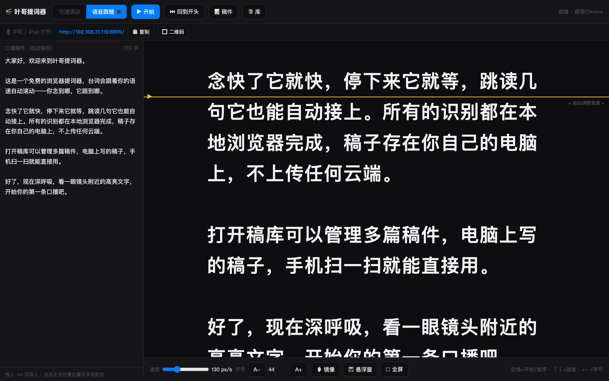

# 叶哥提词器 (Yege Teleprompter)

免费的浏览器语音跟随提词器 —— 台词跟着你的语速走。单文件网页 + 一个 Python 小服务，电脑 / iPad / 手机三端共用一份稿件库。对标商业 App（如小白提词器）的核心能力，零成本、无订阅、数据不出局域网。

[](LICENSE)



## ✨ 功能

- 🎙️ **语音跟随**：开口念，台词自动滚到你正在读的位置（基于浏览器内置语音识别，中文友好）
- 🎯 **模糊对齐**：识别有错别字、念快念慢、跳读漏读都能接上；匹配不上就停在原地等，绝不乱滚
- 📚 **多稿件库**：存任意多篇稿子，点行载入 / 行内重命名 / 两段式删除 / 未保存修改提示
- 🔄 **多设备实时共享**：电脑写稿，手机 5 秒内自动出现（服务器持有唯一数据源）
- 🪞 **镜像模式**：配物理提词器玻璃使用
- 📏 **可调一切**：字号 / 速度 / 朗读线高度，自动保存
- 📱 **三端适配**：桌面 / iPad / 手机布局，手机可「添加到主屏幕」当 App
- 📺 **悬浮窗**（桌面 Chrome）：置顶小窗拖到摄像头旁边
- ⌨️ **快捷键**：空格=开始/暂停 · ↑↓=速度 · +/-=字号 · M=镜像 · F=全屏

## 🚀 快速开始

```bash
git clone https://github.com/yasinshaw/yege-teleprompter.git
cd yege-teleprompter
python3 server.py
```

打开 **http://127.0.0.1:8899** —— 手机/iPad 与电脑连同一 Wi-Fi，扫页面顶部的地址二维码即可共用稿件库。

不想跑服务？直接双击 `index.html` 也能用（语音跟随 + 匀速可用，仅无跨设备同步）。

### macOS 开机自启（可选）

```bash
bash install.sh
```

## 🧠 工作原理

```
语音识别(Web Speech API) → 规范化 → 尾窗模糊匹配(阈值0.45) → 就近优先+全局回退
    → 高亮当前字 + 平滑滚动收敛到朗读线
```

浏览器免费提供识别引擎，对齐算法百来行 JS —— 所以这个能力不需要 App，网页就够了。

## 📱 平台说明

| 端 | 语音跟随 | 匀速滚动 | 多设备同步 |
|---|---|---|---|
| 桌面 Chrome / Edge | ✅ | ✅ | ✅ |
| iPad / 手机浏览器 | ⚠️ 需 HTTPS | ✅ | ✅ |
| file:// 直开 | ✅(桌面) | ✅ | ❌ |

> iOS 语音跟随限制：浏览器要求 HTTPS 才授予语音识别权限，纯 HTTP 局域网开不了。解决方案（自签证书，数据不出局域网）：
>
> ```bash
> bash gen-cert.sh 192.168.31.119   # 换成你的局域网IP（ifconfig | grep inet 查看）
> python3 server.py                  # 检测到证书后自动额外开启 https://<IP>:8443
> ```
>
> iPad/iPhone 信任证书（一次性）：Safari 打开 `http://<IP>:8899/ca.pem` 下载描述文件 → 设置→已下载的描述文件→安装 → 设置→通用→关于本机→证书信任设置→给对应 CA 开启完全信任 → 访问 `https://<IP>:8443`，语音跟随便用。
>
> **Mac 本机也提示"不安全"？** 把 CA 装进钥匙串即可（免 sudo，Chrome/Safari 通用）：
>
> ```bash
> security add-trusted-cert -r trustRoot -k ~/Library/Keychains/login.keychain-db ca.pem
> ```

## 🗂 数据存储

服务器持有 `.library.json`（唯一数据源，自动创建）。所有设备的增删改写回它，其他设备轮询同步。隐私：**数据不出你的局域网，没有云端，没有账号**。备份 = 拷贝这一个文件。

## 🙏 致谢 / 灵感来源

本项目的代码全部为原创实现，但设计过程中参考了以下开源项目的思路，在此致谢：

- **[web-teleprompter](https://github.com/zhang-brook/web-teleprompter)**（zhang-brook）—— 纯网页语音跟随提词器。本项目「朗读线 + 当前字高亮 + 已读变淡」的阅读辅助设计与「识别流尾串对齐稿件」的总体思路与之同源
- **[CueFlow](https://github.com/binghe1980/cueflow)**（binghe1980）—— macOS 语音跟随提词器。其「停顿等待 / 跳读重定位 / 灵敏度」交互范式是本项目对齐算法容错策略的参考
- **[WhisperKit](https://github.com/argmaxinc/WhisperKit)** / **[whisper.cpp](https://github.com/ggerganov/whisper.cpp)** 生态 —— 证明了端侧语音识别做提词跟随的可行性（本项目最终选用浏览器内置引擎以保持零依赖）

如需将本项目用于分发，请一并遵守上述项目的相应开源协议（MIT / Apache-2.0）。

## 📄 License

MIT
